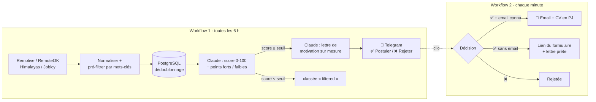

# 🛰️ Remote Job Agent

Agent d'automatisation qui **trouve des offres d'emploi en télétravail adaptées à mon profil, les analyse avec Claude, rédige une candidature personnalisée et me demande validation sur Telegram** avant d'envoyer quoi que ce soit.

> Construit avec **n8n**, **Claude (API Anthropic)**, **PostgreSQL**, **Telegram Bot API** et **Docker**.
> Humain dans la boucle : aucune candidature ne part sans un clic de ma part.

---

## Fonctionnement



Exemple de message reçu :

```
🎯 86/100 — Senior Backend Engineer
🏢 Acme  ·  📍 Worldwide  ·  💰 60000–80000 USD
🔎 remotive  ·  voir l'offre

✅ Points forts
• Stack Node.js/TypeScript alignée
• Remote compatible avec UTC+0
⚠️ Points faibles
• Pas d'expérience Kubernetes en production

📧 Si vous validez : email envoyé à jobs@acme.com avec votre CV.
✉️ Objet : Application – Senior Backend Engineer
…lettre complète…

[ ✅ Postuler ]  [ ❌ Rejeter ]
```

## Points techniques intéressants

| Sujet | Choix |
|---|---|
| **Sorties LLM fiables** | *Structured outputs* (`output_config.format` + JSON Schema) : le score et la lettre arrivent toujours en JSON valide, sans parsing fragile. |
| **Coût maîtrisé** | Pré-filtre par mots-clés **avant** le LLM, plafond `MAX_OFFERS_PER_RUN`, effort `low` pour le scoring et `medium` pour la rédaction. |
| **Dédoublonnage multi-sources** | Clé `entreprise + titre` normalisée, contrainte `UNIQUE` en base, `ON CONFLICT DO NOTHING`. |
| **File d'attente** | Les offres sont stockées en `new` puis consommées par lots : rien n'est perdu si Claude est indisponible, l'offre est retentée au passage suivant. |
| **Validation humaine sans infra** | Polling `getUpdates` de Telegram avec offset persistant : pas besoin d'URL publique, de tunnel ni de webhook, tout tourne en local. |
| **Idempotence et sécurité** | Verrou atomique `UPDATE … WHERE status = 'pending_review' RETURNING` : un double clic n'envoie jamais deux emails. Seuls les clics venant de **mon** chat sont pris en compte. |
| **Anti-hallucination** | Les prompts interdisent d'inventer une expérience absente du profil ; je relis la lettre avant chaque envoi. |
| **Workflows versionnés** | Les workflows sont générés par `scripts/build-workflows.mjs` : le code des nœuds est du vrai JavaScript, relu dans Git, pas un blob JSON. |
| **Tests de bout en bout** | `tests/e2e.sh` lance la stack avec de faux serveurs Claude/Telegram/SMTP et vérifie tout le parcours, sans clé ni coût. |

## Démarrage rapide

Prérequis : Docker, Node.js 18+, Python 3.

```bash
cp .env.example .env          # puis remplissez-le (voir ci-dessous)
```

1. **Clé Claude** : créez-la sur [console.anthropic.com](https://console.anthropic.com) → `ANTHROPIC_API_KEY`.
2. **Bot Telegram** : parlez à [@BotFather](https://t.me/BotFather) → `/newbot` → `TELEGRAM_BOT_TOKEN`.
   Envoyez un message à votre bot, puis ouvrez `https://api.telegram.org/bot<TOKEN>/getUpdates` et récupérez `message.chat.id` → `TELEGRAM_CHAT_ID`.
3. **SMTP** (envoi des candidatures) : avec Gmail, activez la validation en 2 étapes puis créez un [mot de passe d'application](https://myaccount.google.com/apppasswords).
4. **Clé de chiffrement n8n** : `openssl rand -hex 32` → `N8N_ENCRYPTION_KEY`.
5. **Votre profil** : `cp profile/profil.example.md profile/profil.md` puis remplissez-le (plus il est précis et chiffré, meilleurs sont les scores et les lettres) et déposez votre CV anglais dans `profile/cv.pdf` et votre CV français dans `profile/cv-fr.pdf` : l'agent joint automatiquement celui qui correspond à la langue de l'offre.

```bash
./scripts/setup.sh
```

Le script démarre Postgres et n8n, crée les identifiants n8n depuis `.env` (chiffrés, jamais écrits dans les workflows), importe et active les deux workflows.
Ouvrez ensuite <http://localhost:5678>, créez votre compte, puis lancez le workflow 1 avec **Lancer maintenant** pour un premier essai.

## Configuration (`.env`)

| Variable | Rôle | Défaut |
|---|---|---|
| `SEARCH_KEYWORDS` | Mots-clés cherchés dans le titre et les tags (pré-filtre gratuit) | — |
| `EXCLUDE_KEYWORDS` | Mots qui excluent une offre (ex. `intern,principal`) | — |
| `MAX_AGE_DAYS` | Âge maximal d'une offre | `14` |
| `MAX_OFFERS_PER_RUN` | Offres analysées par Claude à chaque passage | `15` |
| `MIN_SCORE` | Score minimal pour être notifié | `70` |
| `CLAUDE_MODEL` | Modèle utilisé | `claude-opus-5-5` |

**Coût indicatif** (estimation, varie selon la longueur des offres) : environ 2 à 5 centimes de dollar par offre analysée avec `claude-opus-5-5`, plus pour les offres qui reçoivent une lettre. Pour diviser la facture par ~40, utilisez `CLAUDE_MODEL=claude-haiku-5-5`, au prix d'analyses moins fines.

## Suivi

```bash
docker compose exec postgres psql -U n8n -d jobs -c "select * from stats;"
docker compose exec postgres psql -U n8n -d jobs -c \
  "select id, score, status, title, company from offers where score is not null order by created_at desc limit 20;"
```

Statuts possibles : `new` → `filtered` | `pending_review` → `rejected` | `applied` | `to_apply_manually` | `send_failed`.

## Tests

```bash
./tests/e2e.sh          # KEEP=1 ./tests/e2e.sh pour garder la stack ouverte ensuite
```

Le test interroge les **vraies** API d'offres, mais remplace Claude, Telegram et le SMTP par des faux (`tests/mock-apis.mjs`, Mailpit). Il vérifie que :

- les offres sont collectées, scorées, et que celles qui dépassent le seuil sont envoyées sur Telegram ;
- ✅ avec email → l'email part avec le CV en pièce jointe ;
- ✅ sans email → le lien du formulaire est renvoyé ;
- ❌ → l'offre est rejetée ;
- un clic venant d'un autre chat est ignoré ;
- une seconde exécution ne renvoie rien en double.

## Structure

```
├── docker-compose.yml          # Postgres 17 + n8n
├── docker-compose.test.yml     # + faux Claude/Telegram + Mailpit
├── db/init.sql                 # schéma, statuts, vue stats
├── profile/profil.md           # votre profil (source de vérité pour Claude)
├── scripts/
│   ├── build-workflows.mjs     # workflows n8n en tant que code
│   └── setup.sh                # installation en une commande
├── workflows/                  # JSON générés, importables dans n8n
└── tests/                      # test de bout en bout + faux serveurs
```

Pour modifier un workflow, éditez `scripts/build-workflows.mjs` puis relancez `./scripts/setup.sh`. Vous pouvez aussi éditer dans l'interface n8n, mais un nouvel import écrasera ces changements.

## Sources et limites

- **Sources** : API publiques de [Remotive](https://remotive.com), [Remote OK](https://remoteok.com), [Himalayas](https://himalayas.app) et [Jobicy](https://jobicy.com), pour un usage personnel et à fréquence raisonnable (au plus 4 fois par jour). Chaque offre renvoie vers son annonce d'origine.
- **Pas de LinkedIn ni d'Indeed** : leurs conditions d'utilisation interdisent le scraping et l'automatisation des candidatures.
- **Formulaires de candidature** (Greenhouse, Lever, Workday…) : non automatisés, volontairement. L'agent vous donne le lien et la lettre prête à coller.
- L'adresse de contact est extraite des liens `mailto:` des annonces. Elle est **affichée avant validation** : vérifiez qu'il s'agit bien d'une adresse de recrutement.

## Pistes d'évolution

- [ ] Relance automatique à J+7 sans réponse
- [ ] Dashboard (Next.js ou Metabase) sur la vue `stats`
- [ ] Pré-filtrage sémantique par embeddings (pgvector) avant Claude
- [ ] CV adapté à chaque offre (PDF généré)
- [ ] Bouton « ✏️ Modifier la lettre » dans Telegram
- [ ] Nouvelles sources (Welcome to the Jungle, We Work Remotely RSS…)
